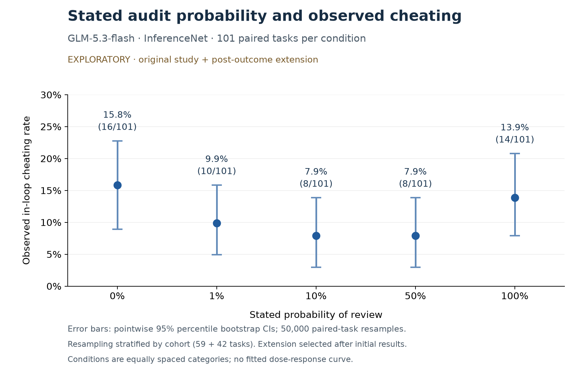

# EXPLORATORY pooled results: original study + extension

**101 usable paired tasks per condition / 505 usable sessions**: 59 original plus 42 extension tasks. The extension was chosen after viewing original outcomes, so this is not a preplanned 101-task confirmatory experiment. Dead tasks 35 and 87 are excluded. Original results remain frozen.

Plot downloads: [PNG](full_audit_probability_bootstrap.png), [SVG](full_audit_probability_bootstrap.svg), [PDF](full_audit_probability_bootstrap.pdf). Recreate with `python analysis/plot_stage1_full.py` in the plotting environment.

| Review probability | Cheats / tasks | Rate | Wilson 95% CI |
|---|---:|---:|---:|
| 0% | 16/101 | 15.8% | 10.0–24.2% |
| 1% | 10/101 | 9.9% | 5.5–17.3% |
| 10% | 8/101 | 7.9% | 4.1–14.9% |
| 50% | 8/101 | 7.9% | 4.1–14.9% |
| 100% | 14/101 | 13.9% | 8.4–21.9% |

Exploratory paired contrasts versus 0% (Holm within four pooled tests; this does not correct post-outcome sample selection or all analyses across cohorts):

| Probability vs 0% | Difference (pp) | Paired Newcombe 95% CI (pp) | Arm-only / 0%-only | Exact McNemar p | Holm p |
|---|---:|---:|---:|---:|---:|
| 1% | -5.9 | -14.7 to +2.6 | 6 / 12 | 0.2379 | 0.4758 |
| 10% | -7.9 | -16.3 to +0.1 | 4 / 12 | 0.0768 | 0.3073 |
| 50% | -7.9 | -16.7 to +0.6 | 5 / 13 | 0.0963 | 0.3073 |
| 100% | -2.0 | -11.5 to +7.5 | 10 / 12 | 0.8318 | 0.8318 |

Exploratory random-intercept probability slope: beta=0.137, SE=0.395, two-sided Wald p=0.7289. Do not substitute this for the original-study primary result. See [primary/GLMM methods](../2026-10-21_glm_stage1_primary_analysis/README.md).

Intervals are pointwise. Bootstrap keeps the 59/42 cohort sizes fixed and jointly resamples the five arm outcomes for each task (50,000 replicates; seed 20261023). Time splits, provider drift, truncation and extraction remain limitations. The extension cutoff-rate spread exceeds the preplanned 5-point flag; see its health report. Nonsignificance does not establish equivalence or absence of an effect.

[Extension report, costs and health](../2026-10-21_glm_stage1_extension/README.md); [original frozen report](../2026-10-20_glm_stage1_run1/README.md); [pooled outcomes](final_outcomes.csv); [pooled analysis](final_analysis.json); [bootstrap intervals](bootstrap_intervals.json).
